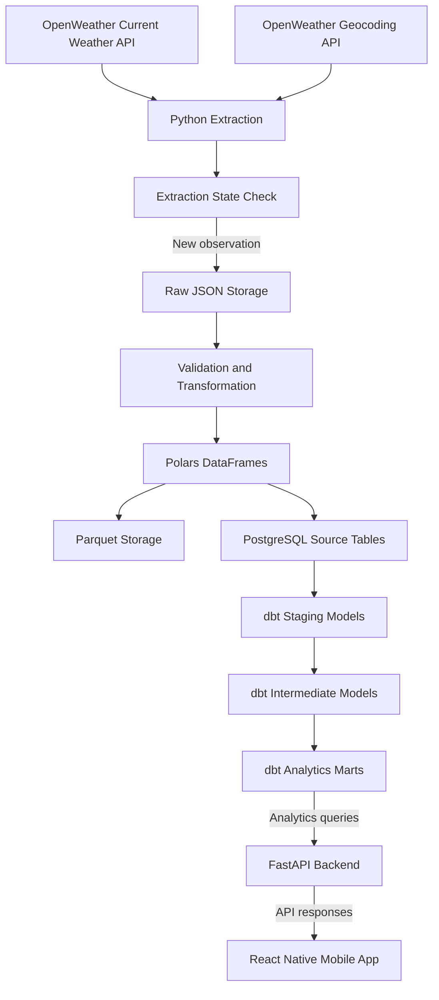

# WeatherFlow — Weather Data Engineering Pipeline

An end-to-end data engineering project that collects current weather data for eight Philippine cities using the OpenWeather API, validates and transforms the data with Python and Polars, stores raw and processed data, and loads it into PostgreSQL for analytics.

The project uses Docker to containerize services, Apache Airflow to orchestrate scheduled ingestion, and dbt to transform source tables into staging, intermediate, and mart models.

## Table of Contents

- [Project Overview](#project-overview)
- [Architecture](#architecture)
- [Technology Stack](#technology-stack)
- [Data Sources](#data-sources)
- [Project Structure](#project-structure)
- [Database Design](#database-design)
- [How to Run the Project](#how-to-run-the-project)
- [How to Run dbt](#how-to-run-dbt)
- [Querying PostgreSQL](#querying-postgresql)
- [Scheduling with Airflow](#scheduling-with-airflow)
- [Known Issues and Improvements](#known-issues-and-improvements)
- [Troubleshooting](#troubleshooting)
- [Future Improvements](#future-improvements)

## Project Overview

WeatherFlow automates the collection and processing of current weather observations from eight cities in the Philippines.

The pipeline performs the following operations:

1. Extracts current weather data using the OpenWeather Current Weather API.
2. Retrieves geographic information using the OpenWeather Geocoding API.
3. Checks extraction state to avoid processing an already-seen weather observation.
4. Saves raw weather responses as JSON.
5. Validates and transforms extracted data using Python and Polars.
6. Saves transformed data as Parquet files.
7. Loads weather and geocoding records into PostgreSQL.
8. Uses Apache Airflow to schedule and monitor pipeline execution.
9. Uses dbt to build staging, intermediate, and analytics mart models.

**Project goal:** Build a practical, containerized data pipeline that demonstrates API ingestion, data validation, incremental processing, database loading, workflow orchestration, and analytics modeling.

## Architecture

### High-level data flow



Apache Airflow orchestrates the Python ingestion pipeline on a schedule. Docker provides the runtime environment for the pipeline, Airflow, and PostgreSQL.

### Architecture layers

| Layer | Responsibility | Main components |
|---|---|---|
| Data sources | Provide current weather and geographic data | OpenWeather APIs |
| Ingestion | Extract API responses and manage extraction state | Python, `extract_api.py`, `state_manager.py` |
| Raw storage | Preserve original API responses | JSON files |
| Processing | Validate, clean, and transform records | Python, Polars, `WeatherTransform` |
| File storage | Store transformed records in a columnar format | Parquet |
| Database | Store queryable source records | PostgreSQL |
| Orchestration | Schedule, retry, and monitor ingestion | Apache Airflow |
| Transformation | Organize source data into analytics-ready models | dbt |
| Analytics | Support weather comparisons, daily summaries, and trends | dbt mart models |
| Runtime | Package and run services consistently | Docker, Docker Compose |

## Technology Stack

- **Python** — API ingestion and pipeline logic
- **OpenWeather API** — current weather and geocoding data
- **Polars** — DataFrame transformations
- **JSON** — raw API response storage
- **Parquet** — processed columnar data storage
- **PostgreSQL** — persistent relational database
- **Apache Airflow** — scheduling, task execution, retries, and monitoring
- **dbt** — SQL-based data transformations and analytics models
- **Docker and Docker Compose** — containerized services
- **uv** — Python dependency and environment management for local development

## Data Sources

WeatherFlow currently uses two OpenWeather endpoints:

- **Current Weather API:** Provides current weather observations.
- **Geocoding API:** Provides geographic information associated with configured locations.

The configured locations are:

- Manila
- Quezon City
- Cebu City
- Davao City
- Baguio
- Iloilo City
- Cagayan de Oro
- Zamboanga City

The API key must be supplied through an environment variable. Do not commit API keys, passwords, or other secrets to the repository.

## Project Structure

The following is a logical overview. Keep the names aligned with the actual files in your repository.

```text
weatherflow/
├── Backend/
│   ├── app/
│   │   ├── api
│   │   │   ├── routes/
│   │   │   │   ├── city_comprison.py
│   │   │   │   ├── current_weather.py
│   │   │   │   ├── daily_weather.py
│   │   │   │   ├── locations.py
│   │   │   │   ├── trends.py
│   │   │   │   ├── weather.py
│   │   │   ├── dependencies.py
│   │   ├── core
│   │   │   ├── config.py
│   │   │   ├── logging_config.py
│   │   ├── db
│   │   │   ├── session.py
│   │   ├── schemas
│   │   │   ├── weather.py
│   │   ├── services
│   │   │   ├── openweather.py
│   │   └── main.py
│   ├── logs/
│   │   ├── city_comprison.log
│   │   ├── current_weather.py
│   │   ├── test.log
│   │   ├── weather_trends.log
│   │   └── backend_main.log
│   ├── src/
│   │   └── weather_transform.py
│   ├── tests/
│   │   ├── test_health.py
│   │   ├── test_postgres_intergration.py
│   │   ├── test_request_logging.py
│   │   ├── test_weather.py
│   │   └── test_weather_schemas.py
│   ├── Dockerfile
│   ├── pyproject.toml
│   └── README.md
├── airflow/
│   └── dags/
│       └── weather_pipeline.py
├── config/
│   └── cities.py
├── data/
│   ├── raw/
│   ├── openweather/
│   ├── parquet/
│   └── state/
├── dbt_weatherflow/
│   ├── models/
│   │   ├── staging/
│   │   ├── intermediate/
│   │   └── marts/
│   ├── dbt_project.yml
│   └── profiles.yml
├── logs/
├── pipeline/
│   ├── ingestion/
│   │   ├── extract_api.py
│   │   ├── save_json.py
│   │   └── state_manager.py
│   ├── validation/
│   │   └── weather_validator.py
│   ├── transformation/
│   │   └── weather_transform.py
│   ├── loaded/
│   │   ├── save_parquet.py
│   │   └── load_postresql.py
│   └── main.py
├── tests/
├── .env.example
├── .gitignore
├── compose.yaml
├── Dockerfile
├── pyproject.toml
└── README.md
```

Some directories may differ depending on your latest implementation. For example, your PostgreSQL loader currently uses the filename `load_postresql.py`; rename it only if you also update every import that references it.

## Database Design

WeatherFlow maintains separate source tables for each configured city.

### Weather tables

```text
openweather_manila
openweather_quezon_city
openweather_cebu_city
openweather_davao_city
openweather_baguio
openweather_iloilo_city
openweather_cagayan_de_oro
openweather_zamboanga_city
```

### Geocoding tables

```text
geocoding_manila
geocoding_quezon_city
geocoding_cebu_city
geocoding_davao_city
geocoding_baguio
geocoding_iloilo_city
geocoding_cagayan_de_oro
geocoding_zamboanga_city
```

The source database therefore contains **16 city-specific tables**. The dbt models use these source tables to create organized staging, intermediate, and mart layers.

### dbt model layers

| Layer | Example models | Purpose |
|---|---|---|
| Staging | `stg_weather_observations`, `stg_geocoding_locations` | Clean and standardize source data |
| Intermediate | `int_city_weather`, `int_daily_weather` | Combine and prepare data for analysis |
| Marts | `mrt_current_weather`, `mrt_daily_weather`, `mrt_weather_trends`, `mrt_city_comparison` | Provide analytics-ready datasets |

The exact schema names and materializations should match your `dbt_project.yml`. In the current project, staging and intermediate models are configured in separate development schemas, while marts use a separate mart schema.

## How to Run the Project

### 1. Prerequisites

Install or configure:

- Docker Desktop with Docker Compose
- Git
- An OpenWeather API key
- Python and uv if you also want to develop or test locally

### 2. Clone the repository

```bash
git clone https://github.com/alaldwin/WeatherFlow.git
cd WeatherFlow
```

Replace the repository URL if your actual repository has a different name or URL.

### 3. Configure environment variables

Create your environment file if your project provides `.env.example`:

```bash
cp .env.example .env
```

Configure the values required by your Compose services. At minimum, the application needs an OpenWeather API key and valid PostgreSQL connection settings.

For the current containerized database, the typical settings are:

```dotenv
OPENWEATHER_API_KEY=your_openweather_api_key

POSTGRES_HOST=db
POSTGRES_PORT=5432
POSTGRES_DB=weatherflow
POSTGRES_USER=weatherflow
POSTGRES_PASSWORD=your_database_password
```

Use the variable names actually read by your code and Compose file. The database hostname `db` works from another container on the same Compose network; it is not the hostname to use from a Windows application such as pgAdmin.

Keep `.env` out of Git.

### 4. Start PostgreSQL and Airflow

From the project root, build the images and start the services:

```bash
docker compose up -d --build db airflow
```

Check their status:

```bash
docker compose ps
```

Check the PostgreSQL health and Airflow logs:

```bash
docker compose logs --tail=100 db
docker compose logs --tail=100 airflow
```

Wait until PostgreSQL reports healthy before running the pipeline.

### 5. Run the ingestion pipeline manually

Run the pipeline inside the Airflow container:

```bash
docker compose exec airflow python -m pipeline.main
```

This runs the Python pipeline once. It is useful for testing ingestion independently of the Airflow scheduler.

A successful run should report that all configured cities were processed, with a final summary showing the number loaded, skipped, and failed.

### 6. Verify the database

Check the row counts for the city-specific weather tables:

```bash
docker compose exec db psql -U weatherflow -d weatherflow -c "


SELECT 'Manila' AS city, COUNT(*) AS rows
FROM public.openweather_manila
UNION ALL
SELECT 'Quezon City', COUNT(*) FROM public.openweather_quezon_city
UNION ALL
SELECT 'Cebu City', COUNT(*) FROM public.openweather_cebu_city
UNION ALL
SELECT 'Davao City', COUNT(*) FROM public.openweather_davao_city
UNION ALL
SELECT 'Baguio', COUNT(*) FROM public.openweather_baguio
UNION ALL
SELECT 'Iloilo City', COUNT(*) FROM public.openweather_iloilo_city
UNION ALL
SELECT 'Cagayan de Oro', COUNT(*) FROM public.openweather_cagayan_de_oro
UNION ALL
SELECT 'Zamboanga City', COUNT(*) FROM public.openweather_zamboanga_city;
"
```

The counts should increase when genuinely new observations are loaded. A successful pipeline run does not guarantee that every table receives a new row, because unchanged observations may be skipped.

### 7. Open Airflow

Open the Airflow UI:

```text
http://localhost:8080
```

Find the `weather_pipeline` DAG and inspect its Grid or task-instance history. The DAG is configured to run hourly at minute zero.

Check the actual task status before concluding that scheduled execution works:

```bash
docker compose exec airflow airflow dags list-runs -d weather_pipeline
```

A successful manual pipeline run and a successful scheduled Airflow task are two separate checks.

## How to Run dbt

Run these commands from the directory containing your `dbt_project.yml` and use the profile configured for the project:

```bash
cd dbt_weatherflow
uv run dbt debug
uv run dbt parse
```

If the connection and project configuration are valid, build the models:

```bash
uv run dbt build
```

`dbt build` runs the applicable models and tests in dependency order. Review the command output for failed models or tests before assuming the analytics layer is current.

If dbt is not installed in your current environment, install the project's declared dependencies first. If you containerize dbt later, use the appropriate service or image rather than assuming these local commands run inside Airflow.

## Querying PostgreSQL

### Connect through pgAdmin

When the database is published on host port `5433`, connect with:

| Setting | Value |
|---|---|
| Host | `localhost` |
| Port | `5433` |
| Maintenance database | `weatherflow` |
| Username | `weatherflow` |
| Password | Your configured database password |

Refresh the database tree, then open:

`Databases → weatherflow → Schemas → public → Tables`

Use Query Tool to inspect source records. If you connect to a separate Windows PostgreSQL server on port `5432`, you may be looking at a different database from the containerized WeatherFlow database.

### Run a SQL query from the terminal

```bash
docker compose exec db psql -U weatherflow -d weatherflow
```

Then run SQL, for example:

```sql
SELECT *
FROM public.openweather_manila
LIMIT 10;
```

Exit `psql` with:

```text
\q
```

PostgreSQL is a database server, not an HTTP web server. Opening `http://localhost:5433` in a browser is not a valid way to inspect the database.

## Scheduling with Airflow

The `weather_pipeline` DAG calls `pipeline.main()` through a Python operator.

Its current configuration is:

- Schedule: `0 * * * *` (hourly)
- Catchup: disabled
- Retries: 2
- Retry delay: 2 minutes
- Task: `run_weather_pipeline`

Airflow retries a failed task according to the DAG settings. For safe retries, database writes and extraction checkpoints must be designed to tolerate the same observation being processed more than once.

## Known Issues and Improvements

### 1. Geocoding rows can be duplicated

**Problem:** The current pipeline appends geocoding records during each run. Since a city's coordinates usually do not change every hour, this can create repeated copies of the same location.

**Recommended fix:** Treat geocoding as reference data. Either update the existing city record or use a stable unique key and an upsert. Avoid deleting and recreating source tables because dbt models may depend on them.

### 2. Weather ingestion needs database-level idempotency

**Problem:** The extraction state manager skips observations whose timestamp is not newer than the saved checkpoint. However, a retry or an interruption between a database insert and checkpoint update can still insert the same observation again.

**Recommended fix:** Define an appropriate unique key, such as `(city, observation_time, source)` if those fields correctly identify a unique observation. Enforce it with a database constraint and use `INSERT ... ON CONFLICT` to make repeated loads safe. Verify the actual table schema before adding constraints.

### 3. The loader's default `replace` mode is risky

**Problem:** Replacing an existing source table can break dbt dependencies. PostgreSQL may reject the drop if dependent views exist.

**Recommended fix:** Use append plus conflict-safe upserts for production-style ingestion. Do not use `replace` on the current source tables. Do not use `DROP TABLE ... CASCADE` to work around dependency errors.

### 4. A manual run does not prove Airflow scheduling works

**Problem:** Running `python -m pipeline.main` successfully proves the pipeline code can run in that container, but it does not prove the scheduler has executed the DAG successfully.

**Recommended fix:** Inspect Airflow's DAG run history and task status in the UI or CLI. Verify a scheduled or manually triggered Airflow task reaches `success`.

### 5. PostgreSQL ports can cause confusion

**Problem:** A Windows PostgreSQL service may use port `5432`, while the WeatherFlow Docker database is published on port `5433`.

**Recommended fix:** Use `db:5432` between Compose containers and `localhost:5433` from Windows tools when the current Compose port mapping is `5433:5432`. Confirm the actual `ports` section in your Compose file.

### 6. A successful pipeline does not guarantee fresh data in every table

**Problem:** The source API may return the same observation timestamp, and the pipeline intentionally skips observations already recorded in its extraction state.

**Recommended fix:** Monitor loaded, skipped, and failed counts, and compare observation timestamps with the expected update frequency. Do not use row count alone as a freshness check.

### 7. Checkpoint and file/database consistency

**Problem:** JSON, Parquet, PostgreSQL, and the state file are separate writes. If one step succeeds and a later step fails, they can temporarily disagree.

**Recommended fix:** Define a clear commit order, update the checkpoint only after the required durable writes succeed, and make each sink safe to retry. Add logging and tests for failures between steps.

### 8. Secrets and environment configuration

**Problem:** Hard-coded API keys or passwords can leak through source control, and a container may receive different environment variables from the local shell.

**Recommended fix:** Use `.env` for local development, exclude it from Git, validate required environment variables at startup, and use appropriate secret management for deployed environments.

### 9. Pipeline tests and data quality checks

**Problem:** A pipeline that runs without exceptions can still load invalid values, duplicates, or incomplete records.

**Recommended fix:** Add tests for API response handling, missing fields, invalid timestamps, duplicate observations, PostgreSQL upserts, and state updates. Add dbt tests for non-null columns, accepted values, and uniqueness where appropriate.

## Troubleshooting

| Problem | What to check |
|---|---|
| PostgreSQL connection refused | Check `docker compose ps`, database health, host, port, username, and password |
| pgAdmin cannot find WeatherFlow tables | Confirm you connected to `localhost:5433` rather than another PostgreSQL instance |
| Airflow DAG missing | Check the DAG file mount, scheduler logs, DAG import errors, and the DAG ID |
| Airflow task fails | Inspect task logs for API, database, import, and transformation errors |
| dbt cannot connect | Run `uv run dbt debug` from the dbt project directory and verify the profile target |
| Duplicate geocoding rows | Replace blind append with a stable-key upsert |
| PostgreSQL refuses to drop a source table | Preserve the table and use compatible schema migrations or conflict-safe loading |
| No new weather rows | Check extraction state, observation timestamps, API responses, and skipped-city logs |
| Browser cannot open PostgreSQL | Use pgAdmin, `psql`, or another PostgreSQL client; PostgreSQL does not serve HTTP |

**Important:** Avoid `docker compose down -v` unless you intentionally want to delete named volumes. It can erase the containerized database and its loaded records.

## Future Improvements

- Implement idempotent PostgreSQL upserts for weather observations and geocoding records.
- Add data quality checks and dbt tests.
- Monitor pipeline freshness, success rates, and API failures.
- Add structured logs and alerting for failed Airflow runs.
- Containerize dbt separately from Airflow.
- Build a FastAPI backend to serve analytics from the dbt marts.
- Build a React Native mobile application for current weather, daily summaries, and city comparisons.
- Add CI checks for Python tests, SQL models, and Docker image builds.

## Project Status

WeatherFlow has a working Python ingestion path for the configured cities, with JSON and Parquet storage, PostgreSQL loading, an Airflow DAG, and dbt models under development.

The next reliability priorities are **idempotent database writes, duplicate-safe geocoding, and verification of scheduled Airflow task runs**.

