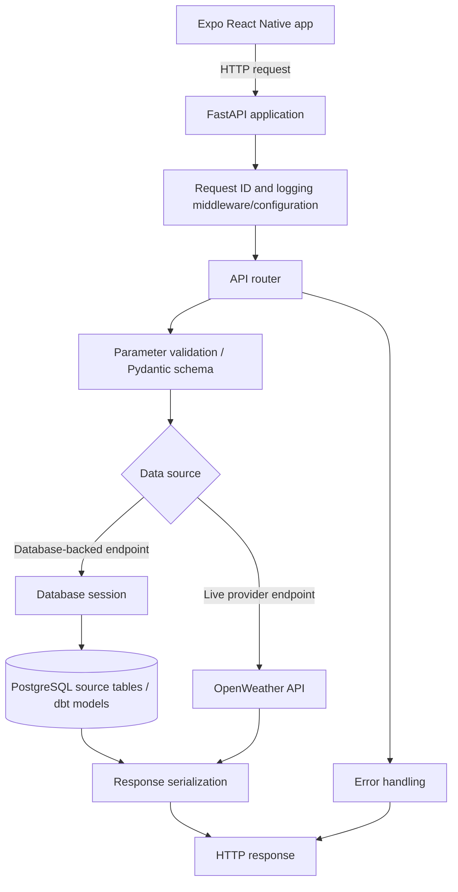

# WeatherFlow Backend Architecture

This document describes the FastAPI backend in WeatherFlow: how routers expose HTTP endpoints, how database access is organized, and how request logging and errors are handled.

> **Implementation note:** This guide reflects the project structure and behavior recorded during development. Route details, database queries, and exact configuration names can change. Confirm them against the current source code before treating this document as a complete code-level specification.

## 1. Backend responsibilities

The backend provides an HTTP API between the WeatherFlow mobile application and the data services. It is responsible for:

- Exposing weather, location-search, and health endpoints.
- Validating request parameters and response data with Pydantic schemas.
- Reading weather data from PostgreSQL/dbt marts where the endpoint is implemented to do so.
- Calling OpenWeather for endpoints that require live forecast or location data.
- Returning consistent HTTP responses and validation errors.
- Logging requests and failures to support debugging and operations.

The mobile application should call FastAPI over HTTP. It should **not** connect directly to PostgreSQL or contain database credentials.

## 2. High-level request flow



The diagram shows the general architecture. Each route's actual data source must be verified in its implementation; not every endpoint should be assumed to query a dbt mart.

## 3. Application entry point

The application entry point is:

```text
backend/
└── app/
    ├── main.py
    ├── routes/
    ├── schemas/
    ├── db/
    └── core/
```

`backend/app/main.py` creates/configures the FastAPI application and registers the API routers. It is also the place to check application-level configuration such as API prefixes, health endpoints, middleware, exception handlers, and startup/shutdown behavior.

A development command used for this project is:

```bash
uv run uvicorn app.main:app --app-dir backend --reload --log-level info
```

For a containerized deployment, the host, port, reload setting, and command should match the Docker configuration. `--reload` is intended for development, not a production process.

## 4. Routers and endpoint responsibilities

Routes are organized under `backend/app/routes/`. The route groups recorded for WeatherFlow include:

| Router / feature | Responsibility |
|---|---|
| `current_weather` | Current weather data, including a list/current-weather endpoint and a city-specific endpoint |
| `daily_weather` | Daily weather summaries |
| `trends` | Weather trend data |
| `city_comparison` | Comparison of weather across cities |
| `locations` | Location search, including geocoding-related search |
| `weather` | General weather endpoints, including coordinate-based current weather and forecast functionality |
| Health endpoints | Application and database health checks |

Known API paths have included the following. Check the current OpenAPI page or router declarations for the exact prefix, parameter defaults, and response models:

| Endpoint path | Intended use |
|---|---|
| `GET /api/v1/locations/search` | Search for locations |
| `GET /api/v1/weather/current` | Retrieve current weather records, with pagination/limit options |
| `GET /api/v1/weather/current/{city}` | Retrieve current weather for a selected city |
| `GET /api/v1/weather/coordinates/current` | Retrieve current weather using coordinates |
| `GET /api/v1/weather/daily` | Retrieve daily weather data |
| `GET /api/v1/weather/trends` | Retrieve weather trend data |
| `GET /api/v1/weather/cities/compare` | Compare weather across cities |
| `GET /health` | Check API process health |
| `GET /health/database` | Check database connectivity |

A forecast endpoint was also being added that requests OpenWeather's five-day forecast data using latitude and longitude. Verify its current route path and query parameters in `backend/app/routes/weather.py` and `backend/app/main.py`.

### Router design principles

A router should generally:

1. Declare the HTTP method and URL path.
2. Validate query/path parameters.
3. Call a focused service or database-access function.
4. Convert the result to a response schema.
5. Return an appropriate HTTP status code.
6. Let shared exception handling/logging capture unexpected failures.

Keep SQL and connection lifecycle management out of UI code. If route files grow too large, service modules can hold reusable business logic while `db/session.py` owns session creation.

## 5. Database access

The database access module is located at:

```text
backend/app/db/session.py
```

It centralizes the database session/connection setup so routes can use a consistent mechanism instead of creating unrelated connections in each handler.

The project uses PostgreSQL. The Docker Compose service is named `db`, and the database container uses port `5432` internally. The host mapping recorded for local tools is `5433:5432`.

Typical connection targets differ by where the API runs:

| API process location | PostgreSQL host and port |
|---|---|
| API running inside the Compose network | `db:5432` |
| API running directly on the Windows/WSL host | `localhost:5433` |
| Mobile emulator | The emulator calls FastAPI over HTTP; it should not connect to PostgreSQL |

Use environment variables for credentials and connection settings. Do not commit secrets or hard-code database passwords in source files. The exact variable names should be checked in `backend/app/core/config.py` and the Compose environment.

### Database-backed data path

Where a route reads a dbt mart, the intended data path is:

```text
OpenWeather ingestion
    → PostgreSQL city-specific source tables
    → dbt staging/intermediate/mart models
    → FastAPI query
    → JSON response
    → Expo mobile UI
```

Known dbt mart names include `mrt_current_weather`, `mrt_daily_weather`, `mrt_weather_trends`, and `mrt_city_comparison`, in the configured `mrt_dev` schema. Confirm the SQL and schema qualification in the route implementation before assuming a particular endpoint reads a specific mart.

Other endpoints, such as live forecast or geocoding search, may call OpenWeather directly rather than read a dbt model. This distinction should be documented per route.

### Database access checklist

- Use a single configured session/connection pattern.
- Close or release sessions reliably, including when exceptions occur.
- Parameterize SQL; do not concatenate untrusted query input into SQL strings.
- Apply limits and pagination to potentially large result sets.
- Handle database unavailability with a clear HTTP error while avoiding leakage of credentials or raw connection details.
- Keep schema/table names controlled by application code or configuration rather than user input.
- Test empty results, invalid parameters, and database connection failures.

## 6. Request IDs and logging

WeatherFlow has application logging configuration in:

```text
backend/app/core/logging_config.py
```

The application has been configured to attach or propagate an `x-request-id` header and to support console/structured logging. The recorded configuration uses `LOG_LEVEL` with `INFO` as the usual level and includes rotating log files. Verify exact formatter names, output destinations, rotation sizes, and retention settings in the current configuration.

### Why request IDs matter

A request ID helps correlate a response with the relevant log entries. When a request fails, record the request ID alongside the endpoint and error so the failure can be traced across application logs.

A useful request lifecycle is:

1. Accept or generate a request ID.
2. Make it available to request logging.
3. Log the HTTP method, route/path, status code, and duration where supported.
4. Include the request ID in the response header.
5. Include the same ID in error logs for that request.

Do not log API keys, database passwords, authorization headers, or unnecessary personal data. Be cautious when logging full query strings or provider responses because they may contain sensitive values.

### Suggested log levels

| Level | Appropriate use |
|---|---|
| `DEBUG` | Detailed local troubleshooting; avoid enabling broadly in production |
| `INFO` | Normal application lifecycle and useful request events |
| `WARNING` | Recoverable issues, unexpected empty provider results, or retryable conditions |
| `ERROR` | A request or operation failed |
| `CRITICAL` | A failure that prevents the service from operating safely |

Avoid logging the same exception at multiple layers unless each log adds meaningful context. Return concise public error messages while keeping diagnostic details in protected logs.

## 7. Validation and error responses

WeatherFlow has used Pydantic schemas under `backend/app/schemas/`, including weather and pagination schemas. FastAPI uses these schemas and parameter declarations to validate input and serialize typed responses.

A validation response has been standardized around an envelope containing an error code such as `VALIDATION_ERROR`. Keep the actual response structure consistent with the exception handler in `main.py`; do not rely on this example as an exact schema unless it matches the current implementation:

```json
{
  "error": {
    "code": "VALIDATION_ERROR",
    "message": "The request parameters are invalid"
  }
}
```

Recommended distinctions:

- **400 Bad Request:** the request is malformed or violates a business rule.
- **404 Not Found:** a requested city/resource does not exist, if that is the chosen API contract.
- **422 Unprocessable Entity:** FastAPI/Pydantic request validation, unless a custom handler maps it to a different status.
- **502/503:** an upstream weather provider or required dependency is unavailable.
- **500 Internal Server Error:** an unexpected server-side failure.

Use the status codes and error envelope actually established by the application. Never send stack traces, SQL text, API keys, or internal filesystem paths to clients.

## 8. Health checks

Two health endpoints have been implemented:

- `/health` — checks that the API process can respond.
- `/health/database` — checks database connectivity.

A healthy API process does not necessarily mean PostgreSQL or OpenWeather is available. The database health check should test the database separately. If a future readiness check depends on additional critical services, define that explicitly rather than making a liveness endpoint fail for every temporary upstream issue.

## 9. Configuration and secrets

Application settings are organized under `backend/app/core/config.py`. Keep environment-specific settings outside source code, including:

- PostgreSQL host, port, database, username, and password.
- OpenWeather API key.
- Log level and log output settings.
- Any provider timeout or API configuration supported by the implementation.

Use a local `.env` file only where the development setup expects one, and ensure secret files are excluded from version control. For Docker Compose, confirm that required variables are passed to the correct service.

## 10. Testing and operational verification

The backend previously passed a test run of `uv run pytest -q` with 53 tests, and Ruff was clean at that point. This is a historical result, not a guarantee about the current checkout. Re-run checks after changes:

```bash
uv run pytest -q
uv run ruff check .
```

Useful manual checks:

```bash
curl -i http://127.0.0.1:8000/health
curl -i http://127.0.0.1:8000/health/database
curl -i "http://127.0.0.1:8000/api/v1/weather/current?limit=10"
```

OpenAPI documentation is typically available at `/docs` when enabled in the FastAPI application. Use it to verify actual paths, parameters, status codes, and response schemas.

## 11. Recommended improvements

- Document the actual data source and response schema for every route.
- Keep route handlers small and move reusable query/business logic into service modules.
- Add explicit timeout and error handling for OpenWeather requests.
- Add tests for provider timeouts, invalid coordinates, missing cities, and database outages.
- Ensure request IDs are present on successful and failed responses.
- Confirm that log rotation and retention match the development or deployment environment.
- Add pagination to all list endpoints that can grow over time.
- Add authentication and rate limiting if the API is exposed beyond a trusted local/demo environment.

## 12. Source files to consult

| File | What to verify |
|---|---|
| `backend/app/main.py` | App creation, router registration, prefixes, middleware, exception handlers, health routes |
| `backend/app/routes/` | Actual route paths, parameters, data sources, and query behavior |
| `backend/app/db/session.py` | Engine/session setup and session lifecycle |
| `backend/app/schemas/weather.py` | Weather request/response schemas |
| `backend/app/schemas/pagination.py` | Pagination fields and validation |
| `backend/app/core/config.py` | Environment variables and settings |
| `backend/app/core/logging_config.py` | Formatters, request IDs, handlers, rotation, and log levels |
| Backend tests | Current API contracts and regression coverage |
