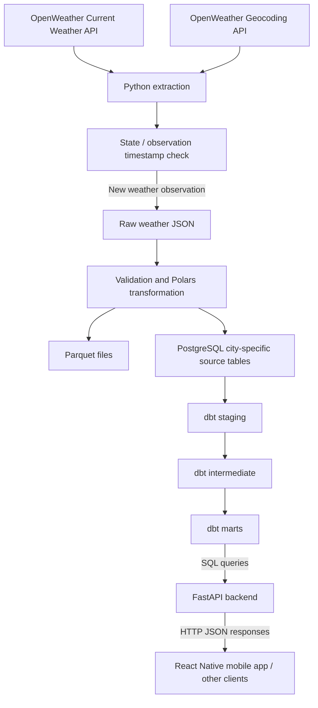
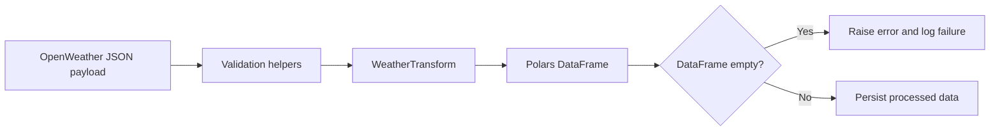
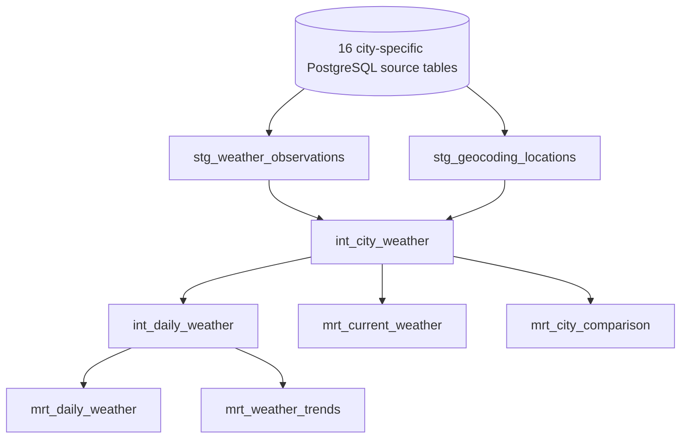
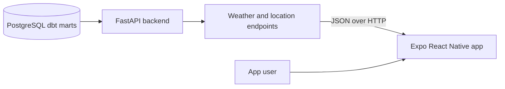

# WeatherFlow Data Flow

This document explains how data moves through WeatherFlow, from OpenWeather API requests to file storage, PostgreSQL source tables, dbt analytics models, and application/API consumption.

> **Implementation note:** This describes the current ingestion behavior established in the project notes. Confirm exact model dependencies, API routes, and task ordering against the current repository before treating every optional step as deployed.

## 1. End-to-End Flow



Apache Airflow orchestrates scheduled pipeline execution and, in the configured workflow, the dbt build. The JSON and Parquet outputs are file-based persistence paths; PostgreSQL is the queryable source and analytics store.

## 2. Extraction

### Data sources

WeatherFlow uses two OpenWeather API capabilities:

- **Current Weather API:** returns a current weather observation for a configured location.
- **Geocoding API:** returns geographic information associated with the configured coordinates/location.

The eight configured Philippine cities are Manila, Quezon City, Cebu City, Davao City, Baguio, Iloilo City, Cagayan de Oro, and Zamboanga City.

### Main components

| Component | Responsibility |
|---|---|
| `config/cities.py` | Supplies city names and coordinates |
| `pipeline/ingestion/extract_api.py` | Calls the OpenWeather current weather and geocoding endpoints |
| `pipeline/main.py` | Coordinates extraction and subsequent pipeline steps |
| `pipeline/ingestion/state_manager.py` | Checks and updates state for processed weather observations |

### Extraction sequence

1. `pipeline/main.py` loops through the configured cities.
2. The pipeline requests current weather data using each city's latitude and longitude.
3. It requests geocoding data for the same configured location.
4. It checks that a weather response exists and contains an observation timestamp (`dt`).
5. It calls `is_new_data(source="openweather", location=city, observation_time=...)` to decide whether the weather observation should be processed.
6. If the weather timestamp is already recorded, the weather part is skipped. The current implementation attempts geocoding loading before this weather-state check, so geocoding records may still be appended on a skipped weather run.

### Extraction state

The state manager is intended to prevent reprocessing an observation with a timestamp that has already been handled. The checkpoint is updated after a successful weather database load.

This is a useful incremental-processing guard, but it is not a replacement for database idempotency. If the process inserts a row and fails before updating the checkpoint, a retry may attempt to insert the same observation again.

## 3. Raw JSON Storage

For a new weather observation, the pipeline saves the original weather API response as JSON using `save_json`.

The raw file preserves the API response for debugging and for comparison with transformed output. The documented naming convention is based on source, city, and date, for example:

```text
data/openweather/<city>_<YYYY-MM-DD>.json
```

Use the actual `save_json.py` implementation to confirm whether a run overwrites a same-day file or uses a different naming convention. JSON is not the final analytics model; it is a raw persistence output.

## 4. Validation and Transformation

### Validation

The pipeline uses validation helpers, including `weather_validator.py`, to check weather data before or during transformation. The exact checks should be read from the current validator implementation; do not assume unverified rules.

Typical data-quality conditions worth enforcing include:

- Required fields are present.
- Observation timestamps are valid.
- Numeric measurements can be parsed.
- City/location values are populated.
- Invalid or incomplete records are rejected or logged clearly.

These are recommended quality conditions, not a claim that every one is currently implemented.

### Polars transformation

`WeatherTransform` in `pipeline/transformation/weather_transform.py` converts the API payload into a Polars DataFrame. The pipeline verifies that the transformed weather DataFrame is not empty before continuing.

High-level flow:



The transformation stage makes the API payload easier to persist as a columnar dataset and load into a relational database. The exact output columns and data types are defined by the current transformation code.

## 5. Parquet Storage

After transformation, `save_parquet.py` writes the Polars DataFrame as Parquet. The current documented directory convention is:

```text
data/parquet/<source>/<city>.parquet
```

Parquet is a columnar file format useful for analytical processing and preserving typed data. The current pipeline appends processed rows to the city's Parquet dataset according to the save implementation.

The file write and PostgreSQL insert are separate operations. If one succeeds and the next fails, the outputs may not match until a retry or repair process reconciles them.

## 6. PostgreSQL Loading

### Source tables

WeatherFlow retains separate PostgreSQL source tables for each city:

- `public.openweather_manila`
- `public.openweather_quezon_city`
- `public.openweather_cebu_city`
- `public.openweather_davao_city`
- `public.openweather_baguio`
- `public.openweather_iloilo_city`
- `public.openweather_cagayan_de_oro`
- `public.openweather_zamboanga_city`

Geocoding source tables follow the `geocoding_<city_slug>` convention, producing eight additional tables. This makes 16 city-specific source tables in total.

### Load sequence

1. The pipeline passes the transformed DataFrame and table name to `load_postgresql`.
2. The loader selects the city-specific legacy-table path for `openweather_*` and `geocoding_*` names.
3. In `append` mode, it ensures new columns can be added and inserts the rows.
4. After the weather insert succeeds, the pipeline updates the weather extraction checkpoint.

### Important loading limitation

The current city-specific legacy loader appends rows; it does not perform an upsert by observation key. The state manager reduces repeated weather inserts, but a retry can still create duplicates if a database insert succeeds before the checkpoint is updated. Geocoding data is also appended on runs where a response is available, so repeated location records are a known risk.

Recommended improvement: identify a stable key for weather observations, add a matching database uniqueness constraint after checking existing data, and use PostgreSQL `INSERT ... ON CONFLICT`. Use a suitable stable key/upsert strategy for geocoding reference data too. Do not replace or drop source tables that dbt models depend on.

## 7. dbt Transformation Layers

dbt reads the PostgreSQL source tables and builds analytics models in dependency order.



The known schemas are:

| Layer | Schema | Example models | Responsibility |
|---|---|---|---|
| Staging | `stg_dev` | `stg_weather_observations`, `stg_geocoding_locations` | Standardize and clean source data |
| Intermediate | `int_devs` | `int_city_weather`, `int_daily_weather` | Prepare joined or aggregated datasets |
| Marts | `mrt_dev` | `mrt_current_weather`, `mrt_daily_weather`, `mrt_weather_trends`, `mrt_city_comparison` | Serve analytical use cases |

This diagram represents the intended relationship based on known model names. The exact lineage must be verified from each model's `ref()` expressions and `dbt docs` artifacts.

### dbt execution

The project has configured dbt to run as part of the Airflow workflow. A dbt build runs the applicable models and tests in dependency order. If running dbt manually, use the configured environment and profile from the dbt project directory:

```bash
cd dbt_weatherflow
uv run dbt debug
uv run dbt build
```

If dbt is only installed in the Airflow container, run it using the actual configured container command instead of assuming a local uv environment has the required packages.

### Why marts matter

Marts present data in shapes that are easier for analytical consumers to query. For example:

- Current weather mart: latest/current weather by city.
- Daily weather mart: daily summaries.
- Weather trends mart: measurements over time.
- City comparison mart: comparable metrics across cities.

The exact grain, columns, and aggregation rules are determined by the SQL models, not by the model names alone.

## 8. API Consumption

The wider WeatherFlow application includes a FastAPI backend and an Expo React Native mobile app. The API layer is the intended boundary between database analytics and the mobile client.



The mobile app should call the backend over HTTP and should not connect directly to PostgreSQL. This keeps database credentials off the device and centralizes request validation, error handling, and response shaping.

### Known backend endpoint groups

The backend has included endpoint groups for:

- Current weather and current weather by city.
- Current weather using coordinates.
- Daily weather.
- Weather trends.
- City comparison.
- Location search.
- Health and database health checks.

A forecast endpoint was also being added to retrieve OpenWeather forecast data using latitude, longitude, and a day range. Confirm the current FastAPI route definitions and OpenAPI document for the exact paths, query parameters, response schemas, and availability.

### Example API-consumption flow

1. The mobile app requests weather for a selected city or GPS coordinates.
2. FastAPI validates the request and queries the appropriate database mart or external weather service, depending on the endpoint's implementation.
3. FastAPI returns a JSON response.
4. The mobile app maps the response into weather cards, forecast charts, and city details.

Not every endpoint necessarily reads from dbt marts: current-weather, forecast, and location-search routes may use different data sources. Inspect each route implementation to determine whether it reads PostgreSQL, calls OpenWeather, or combines both.

### Configuration and networking

- From a host browser or host-based client, the API is typically reached through its published port, commonly `http://localhost:8000` in development.
- From the Android emulator, `10.0.2.2` is commonly used to reach a service on the development host. This only works when the API server is reachable through the expected host/port mapping.
- From another Compose container, use the API service name and internal port if the backend is containerized on the same network.
- Do not use `localhost` inside a container to reach a different container; it refers to the current container itself.

Confirm the mobile app's current base URL in its environment configuration and the backend's published port in Compose.

## 9. Orchestration and Failure Handling

The Airflow DAG uses the ID `weather_pipeline` and is configured for an hourly schedule (`0 * * * *`), with catchup disabled, two retries, and a two-minute retry delay.

The expected workflow is:

1. Airflow triggers the ingestion task.
2. The Python pipeline processes the configured cities and reports failures using a non-zero exit result.
3. On successful ingestion, the workflow runs dbt.
4. Airflow records task outcomes and logs for debugging.

Verify the exact DAG task graph in `airflow/dags/weather_pipeline.py`. A manual command such as `docker compose exec airflow python -m pipeline.main` tests the ingestion module but does not prove a scheduled Airflow run succeeded.

Useful checks:

```bash
docker compose ps
docker compose exec airflow airflow dags list
docker compose exec airflow airflow dags list-import-errors
docker compose exec airflow airflow dags list-runs -d weather_pipeline
docker compose logs --tail=100 airflow
```

## 10. Data Quality and Reliability Recommendations

1. **Make database writes idempotent.** Add a suitable unique key for each weather observation and use conflict-safe inserts.
2. **Avoid geocoding duplication.** Treat city coordinates as reference data and update/upsert by a stable key.
3. **Update checkpoints only after durable writes.** Define which outputs must succeed before marking an observation as processed.
4. **Test failure paths.** Test API errors, missing fields, invalid timestamps, database interruptions, and retries.
5. **Add dbt tests.** Test required fields, uniqueness where valid, accepted values, and data freshness.
6. **Monitor freshness.** Compare the latest observation timestamp with the expected update interval, not just total row counts.
7. **Preserve source table dependencies.** Avoid dropping/replacing source tables used by dbt views; use controlled migrations.
8. **Keep secrets out of the repository.** Supply API keys and database credentials through environment configuration or secret management.

## 11. Summary

WeatherFlow's data path is:

**OpenWeather APIs → Python extraction and state check → JSON raw storage → validation and Polars transformation → Parquet and PostgreSQL source tables → dbt staging/intermediate/marts → FastAPI → React Native app.**

Airflow schedules and monitors the ingestion and dbt workflow. The most important reliability work is making PostgreSQL writes idempotent, preventing repeated geocoding records, verifying the actual Airflow task dependencies, and ensuring each API endpoint's data source is clearly documented.
