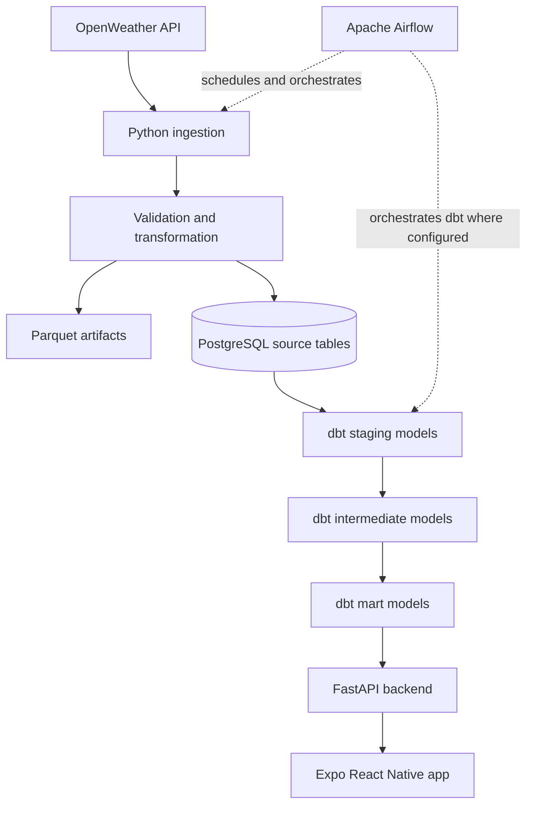

# WeatherFlow — Project Overview

## 1. Introduction

WeatherFlow is a weather-data engineering project that collects weather information from the OpenWeather API, processes and stores the data in PostgreSQL, transforms it with dbt, and exposes selected weather information through a FastAPI backend for a mobile application.

The project brings together data engineering, backend API development, orchestration, and mobile application development in one end-to-end workflow.

> **Documentation note:** This overview describes the project architecture and features recorded during development. Verify the current repository and configuration before treating every endpoint, schedule, or deployment detail as a guarantee of current behavior.

## 2. Project Goals

WeatherFlow aims to:

- Ingest current weather and geocoding information for selected cities in the Philippines.
- Process weather data using Python and Polars.
- Store city-specific source data in PostgreSQL.
- Transform raw source tables into analytics-ready models with dbt.
- Orchestrate recurring pipeline execution with Apache Airflow.
- Provide weather data through a FastAPI HTTP API.
- Present weather information through an Expo React Native application.
- Practice reliable, testable, containerized data pipeline development.

## 3. High-Level Architecture



The diagram shows the intended end-to-end design. Confirm the current Airflow DAG to determine exactly how ingestion and dbt tasks are arranged and whether dbt runs in the same scheduled workflow.

## 4. Data Sources and Coverage

WeatherFlow uses the OpenWeather API for weather observations and geocoding/location information.

The project has been configured for these eight Philippine cities:

- Manila
- Quezon City
- Cebu City
- Davao City
- Baguio
- Iloilo City
- Cagayan de Oro
- Zamboanga City

The database design retains city-specific weather and geocoding source tables: eight `openweather_*` tables and eight corresponding `geocoding_*` tables. See [Data Dictionary](data-dictionary.md) for field-level documentation; verify physical columns and types against the current database schema.

## 5. Technology Stack

| Layer | Technology | Purpose |
|---|---|---|
| Weather source | OpenWeather API | Current weather and geocoding data |
| Ingestion and processing | Python | Extract and coordinate data processing |
| Data transformation | Polars | Transform tabular weather data |
| File storage | Parquet and JSON | Store processed data artifacts and raw responses where configured |
| Database | PostgreSQL | Persist source data and serve analytical models |
| Analytics transformation | dbt | Build staging, intermediate, and mart models |
| Orchestration | Apache Airflow | Schedule and monitor pipeline runs |
| Backend API | FastAPI | Expose weather and location endpoints |
| Mobile application | Expo / React Native | Weather dashboard and user interaction |
| Containers | Docker Compose | Run the local project services |
| Python tooling | `uv`, pytest, Ruff | Dependency management, testing, and linting |

## 6. Data Pipeline

The pipeline's main processing stages are:

1. **Extract:** Request weather and geocoding data from OpenWeather.
2. **Track state:** Check the saved observation state to avoid processing the same weather observation repeatedly.
3. **Transform:** Validate and transform weather data with the project's Python/Polars components.
4. **Save artifacts:** Write raw JSON and transformed Parquet artifacts where configured.
5. **Load:** Append new weather observations and geocoding records to the city-specific PostgreSQL source tables.
6. **Model:** Use dbt to transform source data into staging, intermediate, and mart layers when the configured workflow runs dbt.
7. **Serve:** Let FastAPI endpoints return data from the database/dbt models or from OpenWeather for routes designed to use live provider data.
8. **Display:** The mobile app requests API responses and renders the weather interface.

The implementation has historically appended geocoding records on each successful extraction path, so duplicate geocoding rows are a known data-quality risk to review. State tracking also needs to be considered alongside database writes so a retry cannot create duplicate weather observations.

## 7. dbt Data Models

Known model names include:

- **Staging:** `stg_weather_observations`, `stg_geocoding_locations`
- **Intermediate:** `int_city_weather`, `int_daily_weather`
- **Marts:** `mrt_current_weather`, `mrt_daily_weather`, `mrt_weather_trends`, `mrt_city_comparison`

The recorded mart schema is `mrt_dev`. Exact schemas, model materializations, and dependencies should be confirmed in `dbt_weatherflow/` and its profile configuration.

## 8. FastAPI Backend

The backend is organized under `backend/app/`, with:

- `main.py` for application setup and router registration.
- `routes/` for weather, daily weather, trends, city comparison, and location endpoints.
- `db/session.py` for database session/connection setup.
- `schemas/` for request/response validation.
- `core/config.py` for application configuration.
- `core/logging_config.py` for logging configuration.

Health endpoints include `/health` and `/health/database`. Known API functionality includes current weather, daily summaries, trends, city comparison, location search, coordinate-based weather, and forecast work in progress. Check the running application's `/docs` page and router files for exact paths and behavior.

The mobile application should communicate with FastAPI over HTTP. It should not connect directly to PostgreSQL.

## 9. Mobile Application

The mobile application is built with Expo and React Native. The intended experience includes:

- Selecting or searching for a city.
- Accessing current location when the device grants location permission.
- Displaying current weather details.
- Viewing daily or forecast information.
- Showing weather metrics and trends in a dashboard.

Android emulator networking differs from host networking. The project has used `http://10.0.2.2:8000` as the Android emulator's route to a backend running on the host; the correct base URL depends on where the API is running and how ports are forwarded.

GPS, forecast, and offline-demo behavior should be verified on the current app build. Live OpenWeather calls require internet access; previously stored database data may still be available without an upstream API connection if the backend and database are running and the relevant route is database-backed.

## 10. Running and Verifying Locally

Run commands from the repository root.

### Start the Docker Compose services

```bash
docker compose up -d --build
docker compose ps
```

Inspect service logs if a component is not healthy:

```bash
docker compose logs --tail=100
docker compose logs --tail=100 airflow
docker compose logs --tail=100 db
```

### Verify the API

If the backend is published on host port 8000:

```bash
curl -i http://127.0.0.1:8000/health
curl -i http://127.0.0.1:8000/health/database
```

Open FastAPI's interactive API documentation at `http://127.0.0.1:8000/docs` when enabled.

### Verify the pipeline and dbt

Check the Airflow UI at `http://127.0.0.1:8080` if the Compose configuration publishes port 8080. Review the DAG's latest task status rather than assuming a successful manual pipeline run proves the scheduled workflow is working.

Run dbt using the project's configured environment and profile. Confirm the correct profile directory and target before executing models against a database.

> Commands, ports, service names, and credentials depend on the current Compose and environment configuration. Never commit API keys or database passwords to version control.

## 11. Testing and Quality

The backend previously passed a test run of `uv run pytest -q` with 53 tests, and Ruff was clean at that time. These are historical results; rerun tests after changes.

```bash
uv run pytest -q
uv run ruff check .
```

Additional checks worth maintaining:

- Pipeline tests for empty API responses, provider failures, and retry behavior.
- Database tests for duplicates, null values, and expected column types.
- dbt tests for uniqueness, not-null fields, relationships, and accepted values.
- API tests for validation errors, missing cities, database outages, and provider timeouts.
- Mobile checks for API connectivity, GPS permission handling, and empty/loading/error states.

## 12. Known Risks and Limitations

- **Duplicate data:** Append-only loading can create duplicates if checkpoint updates and database writes are not coordinated or if geocoding is repeatedly appended.
- **External API availability:** Live ingestion, geocoding, and forecast calls depend on provider availability and internet connectivity.
- **Workflow verification:** Confirm the current Airflow DAG to ensure dbt runs as expected in the scheduled pipeline.
- **Route-specific data sources:** Some endpoints may read database/dbt data while others call OpenWeather directly; verify each route.
- **Mobile connectivity:** Emulator and host URLs are not interchangeable in every run configuration.
- **Configuration drift:** Documentation can become stale when Docker Compose, routes, dbt profiles, or environment variables change.

## 13. Documentation Index

- [System Architecture](system-architecture.md) — system components and relationships.
- [Data Flow](data-flow.md) — extraction, processing, storage, dbt, and API consumption.
- [Data Dictionary](data-dictionary.md) — weather and geocoding fields.
- [Backend Architecture](backend-architecture.md) — FastAPI routers, database access, logging, and errors.

## 14. Future Improvements

Potential next steps include:

- Make source-table loads idempotent with stable keys and PostgreSQL upserts.
- Deduplicate or upsert geocoding records.
- Add clearer pipeline freshness and last-success timestamps.
- Verify and document the exact ingestion-to-dbt Airflow dependency graph.
- Add route-level API documentation with sample responses.
- Improve provider timeout handling, retries, and monitoring.
- Add mobile caching and clear offline behavior for database-backed data.
- Add CI checks for tests, linting, and dbt validation.
