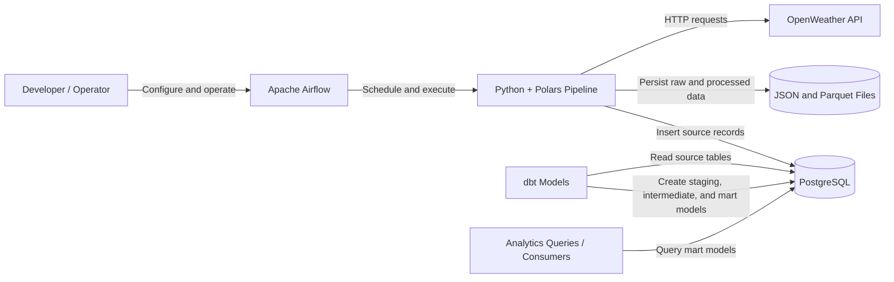
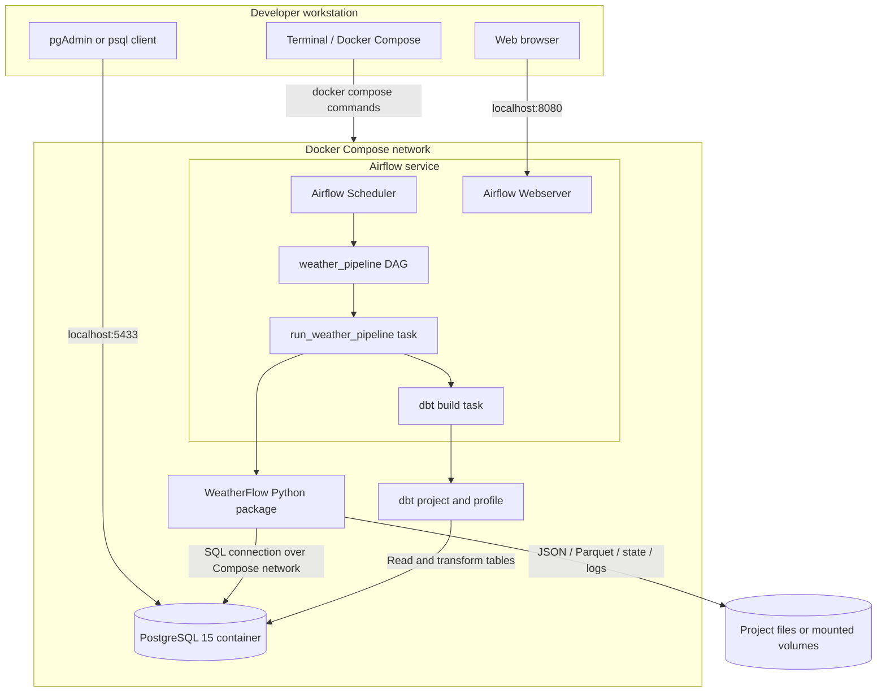
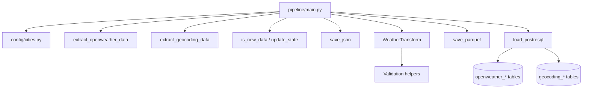
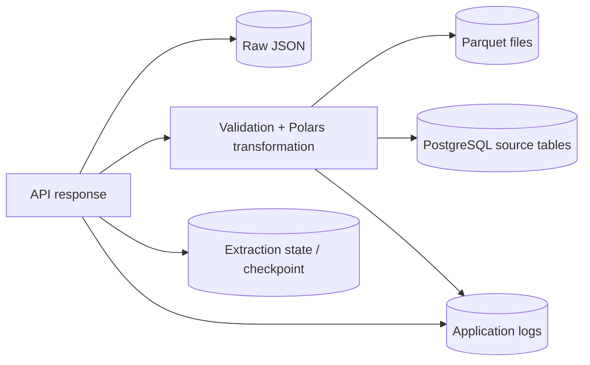
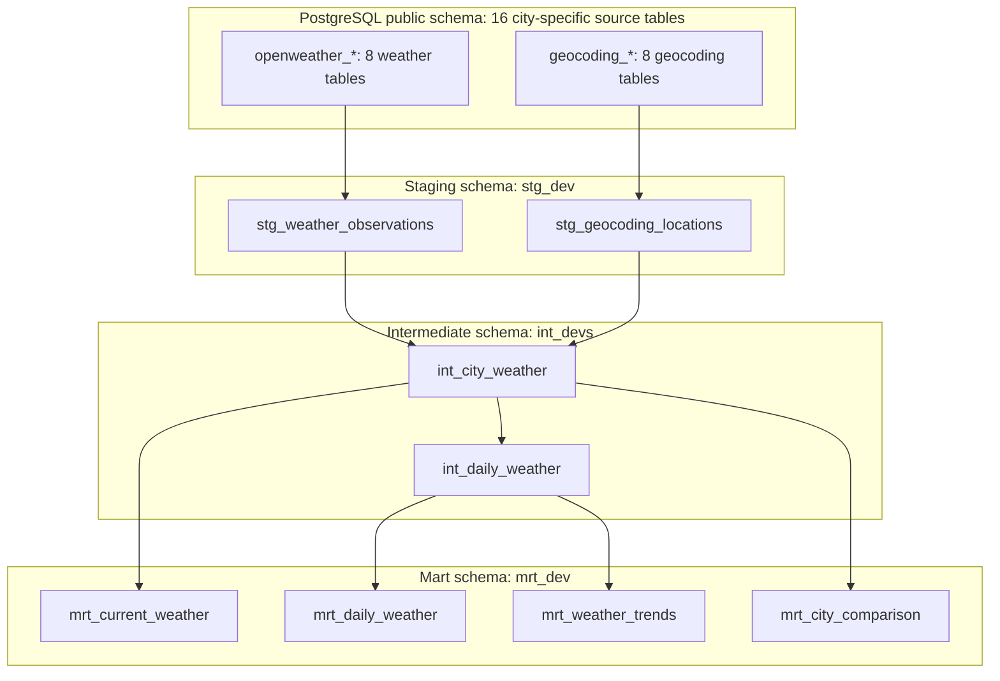
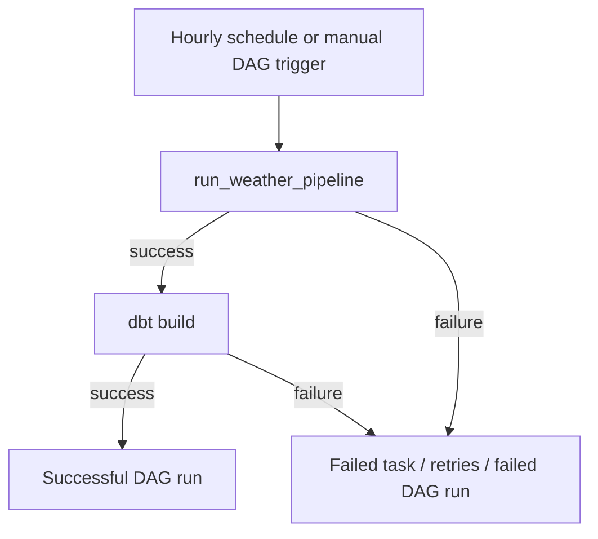
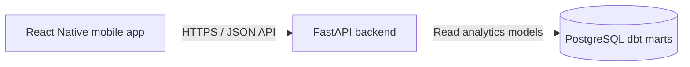

WeatherFlow System Architecture
This document describes the WeatherFlow system, its major components, data flow, runtime relationships, and current operational boundaries.
> **Scope:** This architecture reflects the project structure and behavior described in the current project documentation and conversation. Verify the actual `compose.yaml`, Airflow DAG, dbt configuration, and backend/mobile code before treating every optional or future component as deployed.
1. System Context
WeatherFlow collects current weather and geographic information for eight Philippine cities, processes the records, persists them in files and PostgreSQL, and transforms the source tables into analytics-ready dbt models. Apache Airflow schedules the ingestion and dbt workflow.

2. Runtime / Deployment Architecture
The current deployment uses Docker Compose. PostgreSQL runs in the `db` service and is reachable from the host through port `5433` when the configured mapping is `5433:5432`. Containers on the same Compose network use the database service name and internal port, normally `db:5432`.

Operational notes
The exact service names, volumes, networks, ports, and dbt task implementation must match the checked-in Compose and DAG files.
A manual command such as `docker compose exec airflow python -m pipeline.main` runs ingestion directly; it does not create an Airflow task instance.
Airflow's UI is typically exposed at `http://localhost:8080`.
PostgreSQL is a database protocol endpoint, not an HTTP website. Use pgAdmin or `psql`, not a browser URL, to inspect records.
3. Ingestion Component Relationships

Ingestion sequence
Read city names and coordinates from `config/cities.py`.
Request current weather data from OpenWeather.
Request geocoding data for the configured coordinates.
Transform and append geocoding records to their city-specific source tables when returned.
Read the weather observation timestamp and check the extraction checkpoint.
If the observation is new, save the raw weather response as JSON.
Validate and transform the weather record with Python and Polars.
Save transformed weather data to Parquet.
Append the transformed observation to the matching PostgreSQL weather table.
Update the extraction checkpoint after successful weather loading.
Log the per-city outcome and return a non-zero result if any city failed.
The implementation catches failures per city and continues processing the remaining configured cities. The overall pipeline reports failure if one or more cities failed.
4. Data Storage Architecture

Storage responsibilities
Store	Purpose	Important behavior
JSON	Preserve raw weather API responses	File names include city and date according to the current implementation
Parquet	Persist transformed, columnar records	Files are stored by source and city
PostgreSQL	Queryable source records and dbt models	Sixteen city-specific source tables are retained
State/checkpoint files	Track processed weather observations	Used to skip previously processed observation timestamps
Logs	Record pipeline progress, errors, and summary counts	Useful for debugging manual and scheduled runs
These stores are not one atomic transaction. A failure between file writing, database loading, and checkpoint updates can leave outputs temporarily inconsistent. Retry-safe writes and checkpoint ordering are therefore important.
5. PostgreSQL Source and dbt Model Architecture

The diagram summarizes the known model names and intended layer relationships. Confirm the exact `ref()` dependencies in the dbt SQL files before changing the model graph. dbt builds models in dependency order; the configured materialization determines whether each result is a view or table.
Source table naming convention
Weather tables:
`public.openweather_manila`
`public.openweather_quezon_city`
`public.openweather_cebu_city`
`public.openweather_davao_city`
`public.openweather_baguio`
`public.openweather_iloilo_city`
`public.openweather_cagayan_de_oro`
`public.openweather_zamboanga_city`
Geocoding tables:
`public.geocoding_manila`
`public.geocoding_quezon_city`
`public.geocoding_cebu_city`
`public.geocoding_davao_city`
`public.geocoding_baguio`
`public.geocoding_iloilo_city`
`public.geocoding_cagayan_de_oro`
`public.geocoding_zamboanga_city`
6. Airflow Orchestration
The DAG ID is `weather_pipeline`, and the schedule is `0 * * * *` (hourly at minute zero). Catchup is disabled, with two retries and a two-minute retry delay in the configured DAG defaults.
Expected high-level task relationship:

This relationship assumes the current DAG defines dbt as a downstream task. If dbt is invoked inside the Python task instead, update the diagram to reflect the implementation.
Verify scheduler execution
```bash
docker compose exec airflow airflow dags list
docker compose exec airflow airflow dags list-import-errors
docker compose exec airflow airflow dags list-runs -d weather_pipeline
```
Then inspect the `weather_pipeline` DAG in the Airflow UI at `http://localhost:8080`. Verify the ingestion task and dbt task are both successful. Running the Python module manually is a separate operation from a scheduled DAG run.
7. Component Interfaces
Component	Input	Output / side effect
`config/cities.py`	Static city configuration	City names and coordinates
`extract_api.py`	Coordinates, city, API configuration	Weather and geocoding API response data
`state_manager.py`	Source, location, observation timestamp	New/previously-seen decision and checkpoint update
`save_json.py`	Raw weather response, city, source	JSON file
`weather_transform.py`	API payload and source type	Polars DataFrame
`weather_validator.py`	Extracted or transformed weather data	Validation outcome / validation errors
`save_parquet.py`	Transformed DataFrame, city, source	Parquet file
`load_postresql.py`	Transformed DataFrame, table name, load mode	PostgreSQL rows inserted or updated, depending on loader implementation
Airflow DAG	Schedule or manual trigger	Task execution, retries, status, logs
dbt project	PostgreSQL source tables	Staging, intermediate, and mart models
8. Known Reliability Risks
Duplicate geocoding records
The current ingestion implementation appends geocoding records on each run. Stable coordinates can therefore be stored repeatedly. Use a stable unique key and an upsert or update strategy for reference data.
Duplicate weather observations on retry
The checkpoint helps skip previously seen timestamps, but a failure after a database insert and before the checkpoint update can cause a retry to insert the same observation again. Use a database uniqueness constraint and conflict-safe insert once the correct unique key and existing table schema are verified.
Source-table replacement
Replacing or dropping a source table can break dependent dbt views. Do not use `replace` for the existing `openweather_*` or `geocoding_*` tables, and do not use `DROP TABLE ... CASCADE` to bypass dependency errors.
Multiple outputs are not one transaction
JSON, Parquet, PostgreSQL, and checkpoint files are written independently. Define the checkpoint commit point carefully and make retries safe.
Runtime configuration can drift
Local shell, Airflow container, and PostgreSQL container may use different environment variables or network hostnames. Containers should use the Compose service name and internal port; host clients should use the published host port.
9. Operational Commands
Start or rebuild database and Airflow services:
```bash
docker compose up -d --build db airflow
```
Check services:
```bash
docker compose ps
```
Follow Airflow logs:
```bash
docker compose logs -f airflow
```
Run ingestion manually:
```bash
docker compose exec airflow python -m pipeline.main
```
Inspect weather row counts:
```bash
docker compose exec db psql -U weatherflow -d weatherflow -c \
"SELECT COUNT(*) FROM public.openweather_manila;"
```
Inspect dbt run history through the Airflow task logs, or run dbt directly in the configured dbt environment.
10. Future System Extensions
The wider WeatherFlow project also has plans for a FastAPI backend and an Expo React Native mobile application. These should be treated as application-layer components and connected to PostgreSQL/dbt marts through documented API endpoints, rather than allowing the mobile application to connect directly to PostgreSQL.
Potential future relationship:

The mobile app and backend are not shown as part of the core ingestion path. Confirm that their current containers, API routes, and deployment configuration are operational before documenting them as deployed production components.